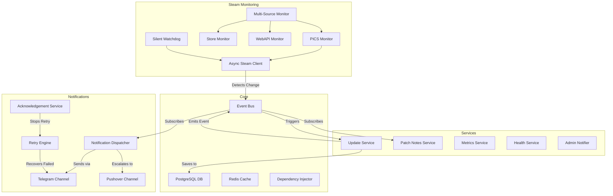
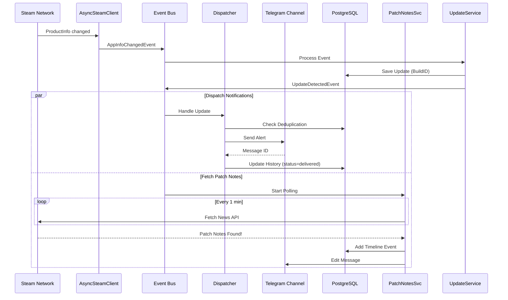

# CS2 Instant Alert — Architecture v1.0.0

Данный документ описывает первую стабильную архитектуру сервиса мониторинга обновлений Counter-Strike 2. Ядро проекта построено с упором на отказоустойчивость, надежность доставки уведомлений и масштабируемость.

## Диаграмма компонентов (Component Diagram)

---

## Схема потока обновления (Update Flow)

---

## Жизненный цикл приложения

1. **Startup (Запуск)**:
   - Инициализация логирования и подключения к PostgreSQL.
   - Инициализация `Dependency Injector` контейнера.
   - Запуск `AsyncSteamClient` (в фоновом потоке gevent).
   - Запуск `EventBus`, `NotificationManager`, `RetryEngine`, `Watchdog`.
   - Восстановление поиска патчноутов для недавних обновлений (`Startup Recovery`).
   - `HealthService` выполняет Self-Test.
   - Отправка `Startup Summary` всем администраторам.

2. **Monitoring (Ожидание)**:
   - `AsyncSteamClient` слушает Steam-сеть. `Watchdog` каждую минуту проверяет статус клиента. Если отвал > 5 минут, администратор получает Alert. 
   - `RetryEngine` периодически пытается доставить неотправленные критические уведомления.
   - Пользователи могут взаимодействовать с ботом (Phase 5).

3. **Update (Обновление)**:
   - При обнаружении нового BuildID запускается асинхронный процесс валидации.
   - Сохранение записи в БД и добавление этапов в `Timeline`.
   - Если включен `Race Mode`, увеличивается частота проверок для быстрого обнаружения патчноутов и размера.
   - `Dispatcher` рассылает оповещения.
   - После получения патчноутов, старое сообщение в Telegram редактируется.

4. **Shutdown (Завершение)**:
   - Сигнал остановки вызывает `.stop()` у всех фоновых сервисов: `Watchdog`, `PatchNotesSvc`, `RetryEngine`, `Orchestrator`, `EventBus`.
   - Все `asyncio.Task` отменяются (`task.cancel()`).
   - Отключение Steam клиента (`logout()`).
   - Закрытие пула соединений PostgreSQL.

---

## Описание Ключевых Сервисов

- **`AsyncSteamClient`**: Глубокая интеграция со Steam на уровне протоколов (gevent + steam). Отслеживает состояние подключения, реализует Exponential Backoff.
- **`MultiSourceMonitor`**: Валидирует изменения через Store API и WebAPI, защищая от ложных срабатываний PICS.
- **`UpdateService`**: Единая точка входа для сохранения обновлений. Записывает `timeline` (последовательность обработки).
- **`PatchNotesService`**: Ищет список изменений. Если находит — безопасно редактирует исходное уведомление, если нет — через 30 минут помечает таймаут. Защищено от падений через Startup Recovery.
- **`NotificationDispatcher`**: Отправляет уведомления. Умеет эскалировать критические уведомления с Telegram на резервные каналы, если отправка не удалась.
- **`RetryEngine`**: Фоновый воркер, который повторяет отправку критических уведомлений по экспоненте (или фикс. интервалу) до тех пор, пока пользователь не нажмет кнопку подтверждения.
- **`AcknowledgementService`**: Обрабатывает действия пользователя ("Я прочитал"), останавливая `RetryEngine`.
- **`SilentWatchdogService`**: Мониторит коннект к Steam. Если Steam лежит больше 5 минут, спамит админу, пока коннект не восстановится. 
- **`AdminNotifierService`**: Сервисный бродкастер системных сообщений (Startup, Restart, БД ошибки).
